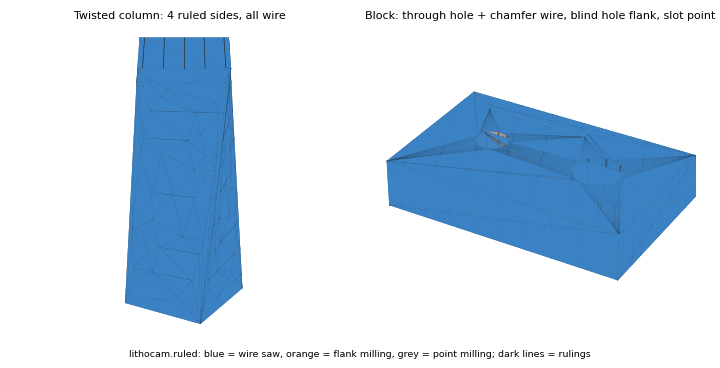
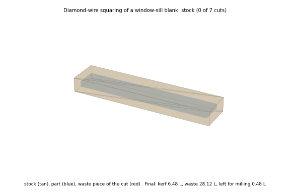
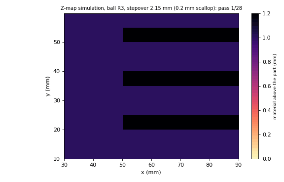
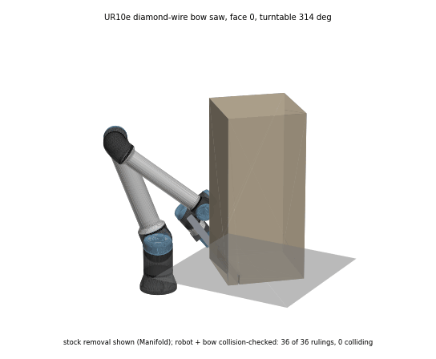
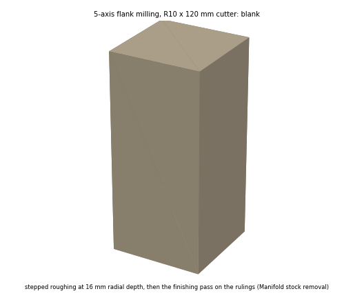
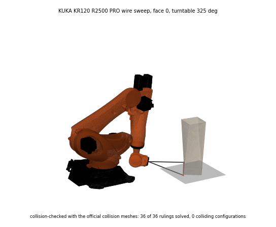
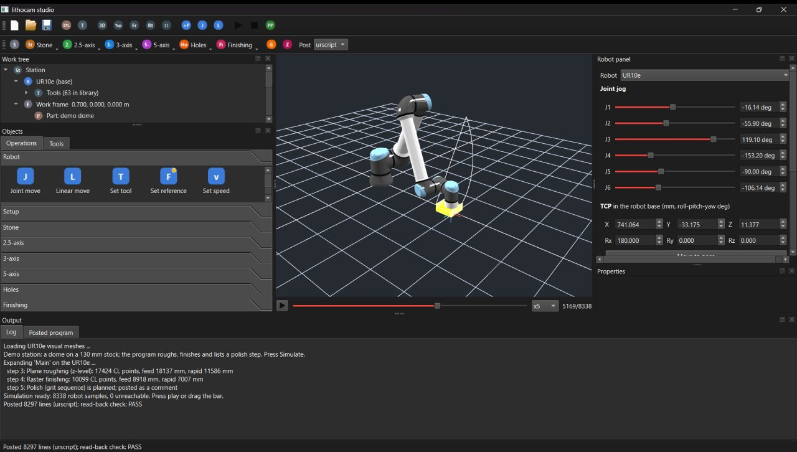

# lithocam

An open, verified CAM layer for stone. lithocam generates the parts of stone toolpaths that general CAM libraries don't:
- wire and disc-saw paths with kerf compensation;
- stone stepover, feed and wear rules;
- engagement maps.

Its output is 5-axis cutter-location data with a tool-spin tolerance and per-point process attributes. Robot motion planners consume that output, for example Tesseract, including arms on a linear track or turntable.

Status: **0.0.1, early.** Main pieces so far:
- verified stepover and kerf, and a Lean-proved wire against a planar face;
- a milling kernel (drop-cutter for four cutter shapes, adaptive zig-zag, Z-map stock simulation), checked against OpenCAMLib;
- ruled-surface extraction for wire saw and flank milling, and a diamond-wire cutting simulation;
- UR10e and KUKA KR120 cells in Tesseract, with a track and turntable, diamond-wire bow saws and collision checks against the official meshes;
- 5-axis flank milling with stepped roughing, and stock removal simulated on meshes (Manifold);
- a tool library of 38 kinds and 63 stone and wood tools, from a sourced survey (`docs/TOOLING.md`);
- post-processing to URScript, KRL, RAPID and a neutral CL text, with a read-back check (`docs/POSTPROCESSORS.md`);
- **lithocam studio**, a Qt program for laying out, simulating and posting stone CAM programs on a robot (below);
- studio operations: drill, core drill, tap and helical bore with dwell and spindle reverse; rest machining, pencil and curvature-adaptive raster; boundary-limited relief finishing; polishing by grit sequence; disc-saw cuts on ruled faces (`docs/STUDIO.md`, `docs/OPERATIONS_HOLES_REST.md`, `docs/POLISHING.md`);
- a turntable driven by the operator, as a coordinated external axis (E1) on KUKA and ABB, or by a PLC over I/O, with the part turning per simulation sample;
- material, feed-limit and tool-wear checks in the studio, each stating which sourced constant it used or lacked (`docs/MATERIALS.md`);
- Python bindings generated with C++26 reflection.

Planned and partial operations are listed in `docs/OPERATIONS.md`. The stock-simulation libraries are compared in `docs/STOCK_SIMULATION.md`.

| | |
|---|---|
|  |  |
| Faces labelled wire, flank or point, with their rulings (`lithocam.ruled`) | Squaring a blank with diamond-wire cuts: kerf, waste and what is left for milling (`lithocam.wiresim`) |
|  |  |
| Finishing in the Z-map simulation at a scallop-verified stepover | UR10e wire sweep along a verified joint path (`lithocam.robot`) |
|  |  |
| 5-axis flank milling: stepped roughing layers, then the finishing pass (`lithocam.flank`, `examples/flank_5axis.py`) | KUKA KR120 with a diamond-wire bow saw on a turntable, collision-checked |

## lithocam studio



One window for stone CAM and robot programming. The layout has the work tree and objects browser on the left, machining operation toolbars on top, the 3D cell view in the centre, the robot panel and step properties on the right, and log and posted-program tabs at the bottom:

- **Work tree.** Station, then robot and tools, then work frame, part and stock, then programs and their steps. Drag steps to reorder them, or drop operations from the palette to insert them.
- **Objects.** An operations palette with stone operations first, then 2.5-axis, 3-axis, 5-axis, holes and finishing. Each icon shows whether the operation is done, partial or planned. Next to it, the tool library, filtered by domain, kind and operation.
- **Robot panel.** Joint sliders, TCP pose entry, Cartesian jog in the base, tool or work frame, the manipulability measure, and buttons to teach MoveJ and MoveL.
- **Properties.** Parameters of the selected step. Its tool drop-down lists only the tools that fit the operation. The Station item holds the material, the table mode (operator, E1 or PLC I/O) and the E1 fields.
- **Simulate and post.** The program expands to verified joint solutions in the background, plays on a simulation bar, and posts to URScript, KRL, RAPID or CL. Each post is checked by reading its joint targets back.

```sh
pip install PySide6 numpy manifold3d
python -m lithocam.studio            # needs the _lithocam module from bindings/
python -m lithocam.studio --smoke out.png   # simulate the demo, capture the window, exit (used for these docs)
```

Toolpaths the studio generates today: face, plane (z-level) roughing, raster, waterline, steep and shallow and 5-axis surfacing, rest machining, pencil and adaptive raster on tools with a drop-cutter model; drill, core drill, tap and bore; polishing; saw cuts on outlines, combs and ruled faces; wire cuts on ruled faces. Flank and pocket run from their own modules and examples.

Studio jogging does not check collisions. `lithocam.robot` (Tesseract) checks programs against the cell meshes. Robot programs are for simulators (URSim, KUKA.OfficeLite, RobotStudio) until a hardware gate is passed.

## Examples

| Example | What it shows |
|---|---|
| `examples/pocket_2p5d.py` | 2.5D pocket with an island: z-level roughing, raster and contour finish, checked in the Z-map |
| `examples/flank_5axis.py` | 5-axis flank milling of a twisted column on the KR120 with a turntable |
| `examples/stone_finial.py OUT` | A procedural finial (Apache-2.0, generated at run time): two-view diamond-wire blank, 3+2 roughing and 5-setup ball surfacing, studio stations for the UR10e and KR120 |
| `examples/bunny_wire_and_mill.py --fetch OUT` | The same pipeline on the Stanford bunny. `--fetch` downloads it once into the user cache, never into the repo. Credit: Stanford University Computer Graphics Laboratory (Turk and Levoy 1994). The Stanford terms do not allow commercial use without permission. `lithocam.meshfix` closes the scan's holes at load |

## Contract: every algorithm has a proof and a test

| Module | C++ | Lean 4 (Mathlib) | Property test |
|---|---|---|---|
| Scallop height and stepover bound | `scallop.hpp` | `Lithocam/Scallop.lean`: `scallop_le_of_stepover_le`, `scallop_maxStepover`, `scallop_mono`, `scallop_eq_stable` | `tests/test_scallop.cpp` |
| Kerf offset of a wire or blade | `kerf.hpp` | `Lithocam/Kerf.lean`: `kerf_strip_outside_part`, `kerf_touches_boundary` | `tests/test_kerf.cpp` (convex parts, circumscribed corners, inscribed-chord negative control) |

**How the proofs relate to the code:**
- The Lean statements are over the real numbers. The C++ is checked against the same statements by seeded property tests, with tolerances relative to part size.
- A statement is either proved or listed as a cited axiom. `sorry` is never allowed, and CI checks for it.
- See `docs/VERIFICATION.md` for the theorem-to-test matrix and the planned modules.

## Stone feature input (`python/`)

`lithocam.features` reads a part as a STEP B-rep and lists the stone operations it needs. Recognition is done by [quiddity](https://github.com/pzfreo/quiddity) (Apache-2.0). lithocam adds the stone layer on top:
- **Stone names and routes.** For example, quiddity's `pockets` record becomes a `kerf_slot` cut by saw disc, `channels` becomes a `drip_groove`, and a through `slot` becomes a `cutout` by contour cut, with the corner radius as the tool radius limit.
- **A priority rule.** Plates, risers, section recesses, the corner fillets of a cutout and the bosses of a turned body do not become extra operations.
- **Pattern grouping.** Equal parallel grooves at a constant pitch are grouped into one set.
- **A revision diff in file coordinates.** It handles symmetric panels, which quiddity's own `correspond` reports as ambiguous.
- **A straight-edge canonicalising pass for Rhino STEP** (`lithocam.step_canon`). Rhino 8 writes every straight edge as a degree-1 B-spline, and without the pass quiddity misses grooves, rebates and cutouts.

```sh
pip install -e "python[features,test]"      # quiddity needs Python 3.11+
python -m lithocam.features part.step --diff part_revB.step
```

### Ruled surfaces: wire, flank or point (`lithocam.ruled`)

`lithocam.ruled` finds, for each face, whether it is swept by straight lines (a ruled surface) and along which direction. Those lines are where a diamond wire or the side of a flank-milling tool can lie. It then checks access along each line with exact line-solid intersection and labels the face:
- `wire`: the wire passes through waste only;
- `flank`: the tool can enter from one side;
- `point`: point milling.

Inside corners keep the wire or tool radius, as on a real machine. The extractor needs OpenCascade (`pip install -e "python[ruled]"`).

```sh
python -m lithocam.ruled part.step --wire-diameter 7 --tool-radius 5 --json faces.json
```

Rhino 8: run `rhino/lithocam_features.py` with RunPythonScript. It marks each operation with a dot coloured by route. Rhino's Python 3.9 calls the `quiddity` executable through `LITHOCAM_QUIDDITY`. See `docs/FEATURES.md` for the rule table, the Rhino findings and the known limits.

## Build

```sh
cmake -S . -B build && cmake --build build --config Release && ctest --test-dir build -C Release
cd lean && lake exe cache get && lake build
cd python && pytest
```

## Bindings

The C++ core is written once. Python bindings are generated with [rosetta](https://github.com/rosetta-bindings/rosetta), using C++26 reflection on a clang-p2996 host. The generated sources are then compiled with ordinary compilers, including MSVC for Blender's Python. This is in progress.

## Data and cells credited

Quarra Stone published ROBOmove backups of their KUKA KR 480 MT and KR 500 stone-milling cells in the public repository [Q-LAB](https://github.com/brnmsmith/Q-LAB): tool tables, end effectors, work-table frames, parameter ranges, program fragments and meshes. lithocam reads those files from a local clone at run time (`LITHOCAM_QLAB`, default `external/Q-LAB` beside the checkout) and does not redistribute them. The repository has no licence file, so none of its files or contents is in this repository. Imported tools and spindle presets carry the source "Quarra Stone Q-LAB (ROBOmove backup)". The KR 480 R3330 MT and KR 500 R2830 MT cells (`cells/`) use dimensions from KUKA's public KR 500 FORTEC manual. See `docs/ROBOMOVE_IMPORT.md`.

## Licence

Apache-2.0. GPL code (for example BlenderCAM or animaquina) is never copied into lithocam. Those projects can use lithocam.
