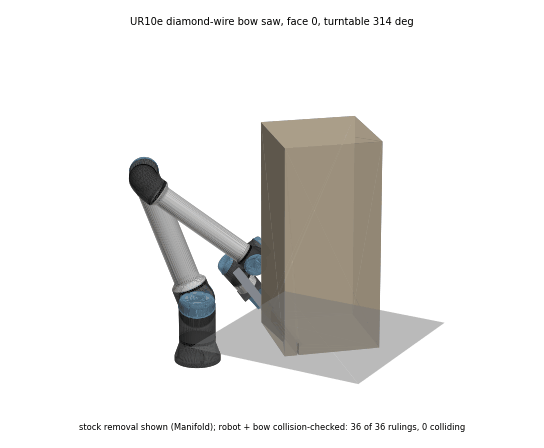
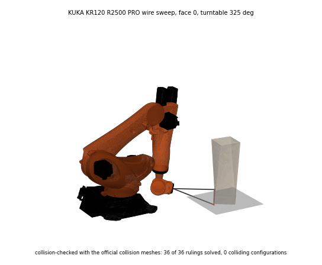

# Robot cells

These are URDF, SRDF and kinematics-plugin files for Tesseract, generated by `make_cells.py`. To regenerate them:

```sh
python cells/make_cells.py
```

| Cell | Robot | Kinematics source | IK |
|---|---|---|---|
| `ur10e` | Universal Robots UR10e | published DH parameters (d1 0.1807, a2 -0.6127, a3 -0.57155, d4 0.17415, d5 0.11985, d6 0.11655) | Tesseract UR solver, verified, with a KDL fallback |
| `kr120` | KUKA KR120 R2500 PRO | ROS-Industrial `kuka_experimental` (BSD) joint origins, axes and limits | OPW, verified, with a KDL fallback |

## How IK is verified

`lithocam.robot.Cell.ik` keeps an analytic solution only when its forward kinematics reach the target and its joints are within limits. When no analytic solution survives, KDL is run from several seeds.

With these files the analytic solvers agree with KDL on most poses, not all: about 83% of solutions for the UR10e and 54% for the KR120. The remaining frame-convention mismatch is an open item. Results are still correct, because every solution is checked.

## Geometry

Visual and collision geometry are the official meshes (`meshes/`, from Universal Robots and ROS-Industrial), placed with the official mesh offsets. Tesseract uses their convex hulls for collision (`tesseract:make_convex="true"`).

 

Both robots are drawn with their official meshes (`meshes/`, licences there). The paths are verified for kinematics only: in the UR10e's face-2 sweep the arm passes through the column. Collision checking against the part is the next step; the cells already carry the official collision meshes.

## External axes

The linear track and the turntable are handled by sampling in `lithocam.robot.wire_reach_ext` (`Positioners`). For each target it tries track positions and table angles nearest-first to the previous choice, then solves the arm's verified IK.

Measured results:

| Robot and part | Fixed | With external axes | Positions used |
|---|---|---|---|
| UR10e, cladding panel | 85% of wire rulings | 100% with the turntable | 0° and 90° |
| KR120, twisted column 3.6 m out | 0% | 100% on a 0 to 3 m track | 0.5, 1.5 and 2.0 m |

### Turntable as a coordinated axis (E1)

A station turntable has a `driven` mode: `operator` (default; the program stops for the operator), `e1` (KUKA and ABB cells: a coordinated external axis) or `io` (a PLC turns it on an output request and reports done on an input). With `e1` the studio adds the table to the Tesseract scene graph at run time as a revolute joint `turntable_e1` about world z through the work origin, carrying the table top and the part (`lithocam.robot.Cell.add_rotary_table`). Every collision check then turns the part to the sample's table angle. The E1 travel, speed and step per wire ruling in the station (`e1_limits_deg`, `e1_speed_deg_s`, `e1_max_step_deg`) are placeholders until set for the cell. The UR10e refuses `e1`.

## Planned

- The linear track as a URDF joint.

## Using Tesseract with these files

Set `TESSERACT_RESOURCE_PATH` to the repository root. Then `package://cells/...` resolves.
