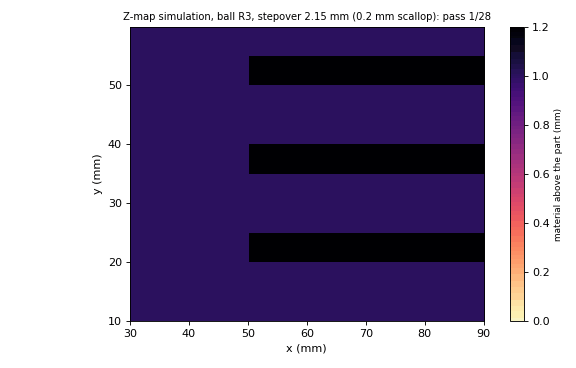

# Milling kernel

lithocam's milling kernel covers the 3-axis surface operations that general CAM libraries such as OpenCAMLib provide. It is written in C++20 from first principles and the published literature, under Apache-2.0. OpenCAMLib's code is not read or copied. OpenCAMLib (LGPL) is used only as a **test oracle**; see `tests/oracle/`.

| Module | State |
|---|---|
| M0 Cutters | flat, ball, bull (torus corner), cone, general line-and-arc profile, thin disc: **done** |
| M1 Mesh index | uniform xy grid over triangle bounding boxes: **done** |
| M2 Drop-cutter | flat, ball, bull, cone, general profile, saw-slot disc: **done** |
| M3 Path drop-cutter, adaptive, zig-zag | **done** |
| M4 Push-cutter, waterline | planned |
| M5 Stock simulation | Z-map (3-axis): **done**; tri-dexel for wire cuts and 5-axis: planned |
| M6 Pocket clearing | planned |

## Drop-cutter (`include/lithocam/dropcutter.hpp`)

The cutter axis is +z. At horizontal distance d from the axis, the cutter's lower surface lies f(d) above the tip:
- ball: f = R - sqrt(R² - d²);
- flat: f = 0.

The drop-cutter height at (x, y) is the maximum of p.z - f(d(p)) over the mesh points under the cutter.

Per triangle the maximum lies at one of these:

| Cutter | Candidates |
|---|---|
| Ball | a vertex; an edge contact (the ball centre at distance R from the edge's line: a quadratic in the centre height, highest root, foot point inside the edge); a facet contact (the centre offset by R along the facet normal, contact point inside the triangle) |
| Flat | a vertex inside the disc; the higher end of an edge clipped to the disc; the disc's highest point on the facet plane (the disc edge in the up-slope direction) |
| Bull, cone | a vertex; an edge contact found by a golden-section search (every profile is convex and nondecreasing, so p.z - f(d) is concave along an edge); a facet contact at the cutter's support point in the direction of the downward facet normal |
| General profile | the same three candidates; see the next section |
| Thin disc | the boundary of the triangle clipped to the disc's slab; see "Saw-slot disc" |

### General profile cutter

`CutterKind::Profile` holds a rotationally symmetric cutter as pieces from the tip outwards, starting at (r, h) = (0, 0). A piece is a line (a cone frustum, or a flat disc when h is constant) or a circular arc with centre (cr, ch) (a torus patch; a sphere zone when cr = 0). An arc uses only the lower-right quarter of its circle (r >= cr, h <= ch), so the surface rises with r. `validate_profile` requires contiguous pieces, strictly increasing r, nondecreasing h and nondecreasing slope df/dr (convex). A vertical tangent is allowed only at the end of the last piece. The listed profiles are convex, so p.z - f(d(p)) stays concave along an edge, as for bull and cone.

Constructors: `tapered_cutter(R, flat_radius, corner, half_angle)` gives a tapered ball (flat 0, corner > 0), a tapered flat end or flat-tipped cone (corner 0, flat > 0), a bull taper (both > 0) or a pointed cone. `burr_cutter(shape, R, L, corner)` gives "flame" (tangent ogive: one arc with centre (R - rho, L), rho = (R² + L²) / (2R), needs L >= R), "ball", "cone" and "cylinder" (flat with corner arc). `profile_cutter(segs)` takes any valid list.

| Contact | Equation |
|---|---|
| Vertex | tip = v.z - f(d(v)) for d(v) <= R |
| Edge | maximum of the concave g(t) = e.z(t) - f(d(t)) over the part of the edge inside the disc, by golden-section search (the same solver as bull and cone, so a line piece's frustum and an arc piece's torus use one path) |
| Facet | the cutter's support point for the plane with upward normal (n_h, n_z): minimise n_z f(r) - |n_h| r over r in [0, R], that is, the first r where f'(r) = s0 = |n_h| / n_z. A line piece with slope s0 touches along its whole generator (both ends are tried). An arc piece touches at the tangent point r = cr + rho s0 / sqrt(1 + s0²), height ch - rho / sqrt(1 + s0²). A kink (flat to cone, arc to line) is touched at its radius. The contact is valid when that point, offset from the tip's xy by r along the up-slope direction, lies inside the triangle |

### Saw-slot disc

`CutterKind::Disc` is a disc of radius R and thickness w whose axis is horizontal and perpendicular to the cut direction (cos h, sin h), `heading` = h. `disc_cutter(R, w, heading)` builds it; for a pass use `heading = atan2(dy, dx)`. The tip is the disc's lowest point, on its mid-plane. The Z-map and `profile` do not apply (they throw `std::invalid_argument`).

Let u be the horizontal coordinate along the cut and l the one along the axis, both measured from the tip's xy. A mesh point with |l| <= w/2 and |u| <= R forces tip >= p.z - f(u), f(u) = R - sqrt(R² - u²): the rim circle in the plane l = const. So the disc is the ball profile in u, restricted to the slab |l| <= w/2.

Per triangle:
1. Clip the triangle to the slab. The result is a convex polygon P (at most 5 vertices).
2. On the triangle's plane p.z is linear in (l, u), so for fixed u the bound is linear in l and its maximum lies on the boundary of P. A vertical triangle's maximum lies on its top edges, also on the boundary.
3. The boundary has two kinds of piece: parts of the triangle's edges (rim-edge contacts) and the chords where the triangle crosses the disc's two flat faces l = ±w/2 (face contacts). Each piece, clipped to |u| <= R, is a segment with end points A, B. Along it g(t) = z(t) + sqrt(R² - u(t)²) - R is concave. The stationary point is closed form: u* = R dz sgn(du) / hypot(du, dz), with du, dz the changes from A to B, and t* = (u* - A.u) / du. The candidates are the two clipped ends and t* when it lies inside.

The indexed query uses the half diagonal hypot(R, w/2) as its search radius. `adaptive_line` runs unchanged with a disc whose heading follows the pass. Along the pass l is constant for every mesh point, so the height has no jump along it (it does between passes, where a ridge enters the slab).

## Adaptive path (`pathdrop.hpp`)

The path is sampled at `max_step`. An interval is subdivided while its midpoint or quarter points leave the chord by more than `tol`.

Where the cutter first meets a sharp edge, the CL height rises like a square root. A chord across even 0.02 mm then sags about 0.1 mm below the true path (3 mm ball), and the Z-map simulation showed that as a gouge along the part's edge. Deviation therefore keeps refining down to `min_step / 1000`; a change of contact alone stops at `min_step`.

## Stock simulation (`zmap.hpp`)

The stock is a height field. Each linear cutter move lowers every cell to the swept lower envelope: the minimum over the move of tip height + f(distance). The tip height is linear and f(distance) is convex, so a golden-section search finds the envelope.

`target_heights` casts a vertical ray per cell, so stock - target gives leftover (+) or gouge (-).

**End to end against the scallop theorem** (`tests/test_zmap.cpp`). A flat floor milled by a ball at `max_stepover(R, h)` leaves cusps that peak at h:

| h (mm) | Simulated peak (mm, grid 0.02) | Gouge |
|---|---|---|
| 0.020 | 0.01991 | none |
| 0.050 | 0.04988 | none |
| 0.200 | 0.19996 | none |

A single plunge reproduces the cutter profile to 1e-12 for all four cutter kinds. On wavy terrain, a drop-cutter zig-zag gouges at most 0.012 to 0.014 at a path tolerance of 0.01.

## Evidence

**Property tests** (`tests/test_dropcutter.cpp`, 8,007 cases):
- closed-form cases;
- no gouge: no sampled mesh point lies above the cutter surface;
- contact: the result matches dense sampling within the sampling error;
- the grid index equals brute force.

**Mutation check:**

| Mutant | Failures |
|---|---|
| ball edge contact removed | 364 |
| flat facet contact removed | 74 |

**General profile** (`tests/test_dropcutter_profile.cpp`, 25,721 cases, about 17 s):
- 12,000 random convex profiles (tapered ball, tapered flat, bull taper, flame, ball, cone and cylinder burrs, random chains of up to four line and arc pieces) against random triangles. Three checks per case (`tests/test_dropcutter_props.hpp`): no sampled triangle point above the cutter, no sampled point of the cutter's lower surface below an overhead triangle (distance >= -1e-9), and tight contact: the height equals an independent nested golden-section maximiser to 1e-6 (triangles with slope up to 20);
- agreement with the exact models over 2,500 random cases each: ball (hemisphere burr), flat, bull, cone (pointed cone burr) and cone (tapered cutter without flat or corner). Worst relative difference 1.5e-14;
- lifting the mesh by d lifts the height by d (1e-9); lifting part of it never lowers the height; the grid index equals brute force;
- closed forms (tapered ball on a plane and on its arc and flank, flat-tipped cone, flame vertex) and rejection of non-convex, falling or mismatched profiles.

**Saw-slot disc** (`tests/test_dropcutter_disc.cpp`, 17,254 cases, about 1.5 s):
- 12,000 random discs and triangles, the same three checks, the tight-contact reference being a nested golden-section search over l and u;
- closed forms: plane, vertex on the rim, vertex outside the slab, face contact, rim contact, a quarter-turn heading, an extruded profile (the 2D case);
- rotating mesh and heading together keeps the height; a thicker disc is never lower; lifting; index equals brute force; `adaptive_line` with the heading of the pass.

**Mutation check for the new models** (`tests/test_dropcutter_mutation.cpp`, which builds `src/dropcutter.cpp` with `LITHOCAM_MUTATE`; 2,500 cases per row; the control row with no defect has 0 failures):

| Mutant | Failing cases |
|---|---|
| profile facet contact removed | 132 |
| profile edge contact removed | 503 |
| profile arc support at the arc end instead of the tangent point | 69 |
| disc face contact removed | 90 |
| disc rim stationary point removed | 290 |
| disc second face ignored | 407 |

The oracle (OpenCAMLib) has no profile or disc cutter in this comparison; the new models are checked against the exact models and against independent maximisers, not against OpenCAMLib.

**Differential test against OpenCAMLib 2023.01.11.** Mesh: 3,240 triangles (terrain plus loose triangles). Queries: 3,000 points for each of ball and flat cutters at R 1.5 and 6.

| Cutter | R | max \|difference\| | nan mismatches |
|---|---|---|---|
| ball | 1.5 | 1e-12 | 0 |
| ball | 6 | 1e-12 | 0 |
| flat | 1.5 | 1e-12 | 0 |
| flat | 6 | 1e-12 | 0 |
| bull, corner 1 | 3 | 1.2e-9 | 0 |
| bull, corner 0.5 | 6 | 5.4e-10 | 0 |
| cone, half-angle 45° | 3 | **4.4** (608 of 3,000 points) | 0 |
| cone, half-angle 30° | 6 | **3.4** (673 of 3,000 points) | 0 |

Ball and flat agree at print precision. Bull agrees at the precision of the golden-section edge search.

**The cone does not agree.** At about 20% of the points, OpenCAMLib's `ConeCutter` gives a *lower* tip height than lithocam. An independent dense sampling of every triangle under the cone, written separately from both implementations, agrees with lithocam:

| Point | Sampled | lithocam | OpenCAMLib |
|---|---|---|---|
| 2131 | 4.9721 | 4.9721 | 1.5999 |
| 811 | 7.0013 | 7.0020 | 4.7634 |
| 1393 | 1.8347 | 1.8348 | — |

Passing OpenCAMLib the full included angle, or a quarter of it, does not remove the difference. At those points OpenCAMLib's cone result appears to gouge. Under the clean-room rule its code is not read, so the cause is not known. The case (`tests/oracle/make_case.py`, seed 7) is a candidate for an upstream issue report.
